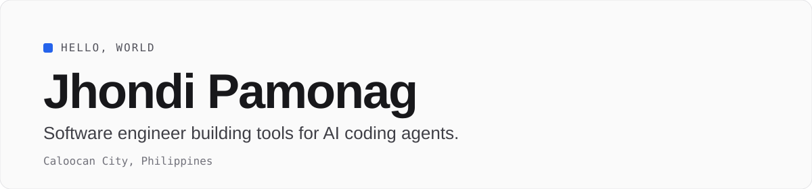

  

  
  

## About

I build developer tooling, mobile apps and web interfaces. Most of my recent work makes AI coding agents easier to set up and share across a team.

## Stack

| | |
|---|---|
| **Web** |     |
| **Mobile** |   |
| **Backend** |   |

## Selected projects

| | |
|---|---|
| **[movegent-kit](https://github.com/ednaaaj/movegent-kit)** One command to set up Claude Code, Cursor, Gemini CLI, Antigravity and Codex with your team's skills, Jira and Slack. JavaScript | **[pluracam](https://github.com/ednaaaj/pluracam)** Camera app for iOS. Swift |
| **[trucking-tracker](https://github.com/ednaaaj/trucking-tracker)** Tracker for trucking software. TypeScript | **[dev-null.sh](https://github.com/ednaaaj/dev-null.sh)** Shell and PHP experiments. PHP |

## GitHub activity

  
  

## Play

Take a break and beat my high score: **[ednaaaj.github.io/ednaaaj](https://ednaaaj.github.io/ednaaaj/)**
